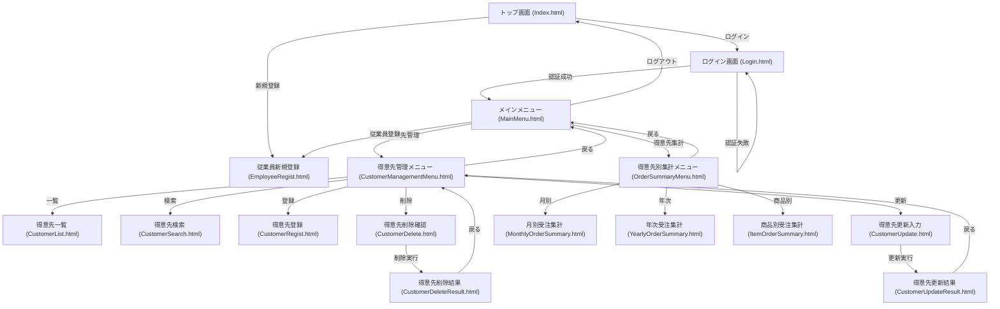
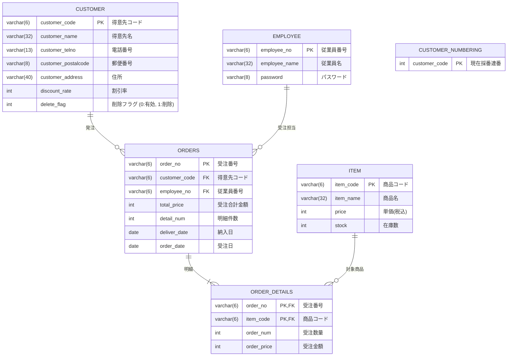

# 販売支援システム システム設計書（完成版 ver.5）

## 1. システム概要
本システムは、株式会社健康食品ロイヤル社における「得意先管理業務」および「得意先別集計業務」を支援するWebアプリケーションです。  
Django 5.1（Python 3.13）とMySQL 8.3をベースに構築され、レスポンシブなBootstrap 5 UIを備えています。

---

## 2. システム構成と画面遷移図

### 2.1 画面遷移図 (Mermaid)

---

## 3. データベース構造 (ER仕様)

---

## 4. URLルーティング仕様

| URLパス | ビュー関数 | メソッド | 説明 | 認証 |
|:---|:---|:---|:---|:---|
| `/` | `views.Index` | GET | トップポータル画面 | 不要 |
| `/Login` / `/login` | `views.login_view` | GET/POST | ログイン画面および認証処理 | 不要 |
| `/logout` | `views.logout_view` | GET | ログアウト・セッション破棄 | 不要 |
| `/MainMenu` | `views.MainMenu` | GET | 管理メニュー画面 | **必須** |
| `/CustomerManagementMenu` | `views.CustomerManagementMenu` | GET | 得意先管理メニュー画面 | **必須** |
| `/CustomerList` | `views.CustomerList` | GET | 有効得意先の一覧表示 | **必須** |
| `/CustomerSearch` | `views.CustomerSearch` | GET/POST | 得意先コード検索画面 | **必須** |
| `/CustomerRegist` | `views.CustomerRegist` | GET/POST | 得意先新規登録（自動採番） | **必須** |
| `/CustomerDelete` | `views.CustomerDelete` | GET/POST | 得意先削除確認（論理削除） | **必須** |
| `/CustomerDeleteResult` | `views.CustomerDeleteResult` | GET | 削除完了画面 | **必須** |
| `/CustomerUpdate` | `views.CustomerUpdate` | GET/POST | 得意先情報更新画面 | **必須** |
| `/CustomerUpdateResult` | `views.CustomerUpdateResult` | GET | 更新完了画面 | **必須** |
| `/OrderSummaryMenu` | `views.OrderSummaryMenu` | GET | 得意先別集計メニュー画面 | **必須** |
| `/MonthlyOrderSummary` | `views.MonthlyOrderSummary` | GET | 月別受注集計画面 | **必須** |
| `/YearlyOrderSummary` | `views.YearlyOrderSummary` | GET | 年次受注集計画面 | **必須** |
| `/ItemOrderSummary` | `views.ItemOrderSummary` | GET | 商品別受注集計画面 | **必須** |
| `/EmployeeRegist` | `views.EmployeeRegist` | GET/POST | 従業員新規登録画面 | 不要/任意 |

---

## 5. 各画面の仕様詳細

### 5.1 ログイン画面 (`Login.html`)
- **入力項目**:
  - `Employee_no` (Text, 6桁)
  - `password` (Password, 8桁)
- **ボタン**:
  - `loginButton`: ログイン認証実行
  - `topButton`: トップページへ遷移
- **メッセージ**:
  - 認証失敗時: 「ID またはパスワードが違います。」

### 5.2 得意先登録画面 (`CustomerRegist.html`)
- **自動採番**: `customer_numbering` テーブルの最新連番 + 1 を `RAxxxx` 形式で生成。
- **入力項目**:
  - 得意先名（必須、32文字以内）
  - 電話番号（必須、13文字以内）
  - 郵便番号（必須、8文字以内）
  - 住所（必須、40文字以内）
  - 割引率（数値、0〜99）
- **メッセージ**:
  - 成功時: 「登録が完了しました。」
  - エラー時: 「登録できませんでした。」（詳細なバリデーションエラーをリスト表示）

### 5.3 得意先削除画面 (`CustomerDelete.html`)
- **処理仕様**:
  - 過去の受注明細（`orders` テーブル）との参照整合性を維持するため、物理削除ではなく `delete_flag = 1` による論理削除を実施。
  - 削除完了後は `CustomerDeleteResult.html` にて「削除しました。」を表示。

### 5.4 集計画面（月別・年次・商品別）
- **月別受注集計 (`MonthlyOrderSummary.html`)**:
  - 年・月を指定して実行。
  - 得意先コードごとに合計金額（税込）を集計し、最下部に総計を表示。
- **年次受注集計 (`YearlyOrderSummary.html`)**:
  - 年を指定して実行。得意先別合計金額および総合計を表示。
- **商品別受注集計 (`ItemOrderSummary.html`)**:
  - 得意先コードを指定して実行。
  - 得意先名を表示し、受注のある商品ごとの単価・数量・小計・総計を算出。
